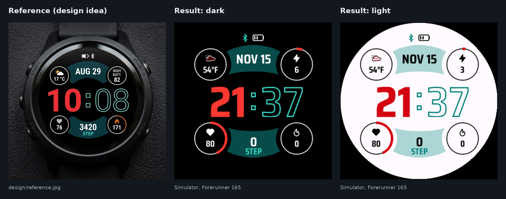

# Neon Frosh

A Garmin Connect IQ watch face for round watches: big two-tone time, six data fields you choose, eight colors, light or dark background.



It is the worked example of the [garmin-watch-face-dev](https://github.com/peekra/garmin-watch-face-skill) Claude Code skill: left the reference image, right the face that came out of it.

## Features

- Hours solid, minutes as an outline, in two colors you pick (8 colors).
- Six data fields: date, weather, energy level, heart rate, active and total calories, steps, weekly run, bike, swim, climbing and training, VO2 max. Any field can stay empty.
- Progress rings on the round fields.
- Light or dark background, battery and phone status.
- Always-on view on AMOLED watches (time only, shifted every minute against burn-in).
- Settings on the watch and in the Garmin Connect IQ phone app.
- 59 round watches: 40 AMOLED and 19 MIP (list in `manifest.xml`), Connect IQ 5.2 or newer.

## Build

You need the [Connect IQ SDK](https://developer.garmin.com/connect-iq/sdk/) (tested with 9.3.0 on macOS) and your own developer key. The key is never part of this repository.

```bash
export DEVELOPER_KEY=~/.garmin/developer_key.der   # your own key
scripts/build.sh fr165          # one device  -> bin/fr165.prg
scripts/build.sh all            # all 59 devices
scripts/test.sh fr165           # unit tests in the simulator
scripts/install-watch.sh fr165  # release .prg for the watch
scripts/package.sh              # store package .iq
```

Copy the `.prg` to `GARMIN/APPS/` on the watch over USB.

## Project notes

- `CLAUDE.md`: specification and decisions, `STATUS.md`: state of the last release.
- `design/`: reference image, drafts, store images and texts.
- Third-party fonts and icons: see [NOTICE.md](NOTICE.md).

## License

MIT, see [LICENSE](LICENSE). Fonts and icons keep their own licenses.
